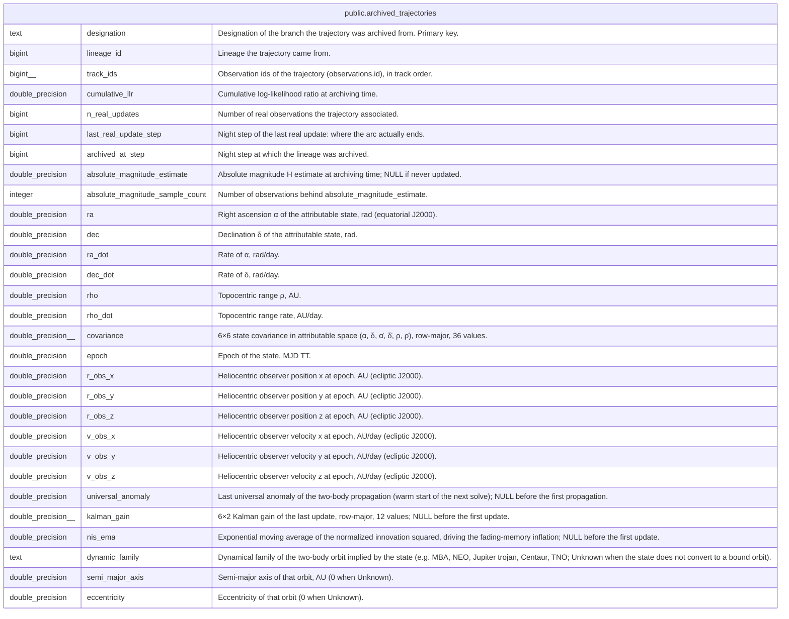

# public.archived_trajectories

## Description

Closed trajectories: lineages that stopped being propagated (stale purge) but whose association history is kept as a result, with their final MAP Kalman state. Keyed by designation; only ever inserted into between full reloads.

## Columns

| Name                            | Type               | Default | Nullable | Children | Parents | Comment                                                                                                                                                              |
| ------------------------------- | ------------------ | ------- | -------- | -------- | ------- | -------------------------------------------------------------------------------------------------------------------------------------------------------------------- |
| designation                     | text               |         | false    |          |         | Designation of the branch the trajectory was archived from. Primary key.                                                                                             |
| lineage_id                      | bigint             |         | false    |          |         | Lineage the trajectory came from.                                                                                                                                    |
| track_ids                       | bigint[]           |         | false    |          |         | Observation ids of the trajectory (observations.id), in track order.                                                                                                 |
| cumulative_llr                  | double precision   |         | false    |          |         | Cumulative log-likelihood ratio at archiving time.                                                                                                                   |
| n_real_updates                  | bigint             |         | false    |          |         | Number of real observations the trajectory associated.                                                                                                               |
| last_real_update_step           | bigint             |         | false    |          |         | Night step of the last real update: where the arc actually ends.                                                                                                     |
| archived_at_step                | bigint             |         | false    |          |         | Night step at which the lineage was archived.                                                                                                                        |
| absolute_magnitude_estimate     | double precision   |         | true     |          |         | Absolute magnitude H estimate at archiving time; NULL if never updated.                                                                                              |
| absolute_magnitude_sample_count | integer            |         | false    |          |         | Number of observations behind absolute_magnitude_estimate.                                                                                                           |
| ra                              | double precision   |         | false    |          |         | Right ascension α of the attributable state, rad (equatorial J2000).                                                                                                 |
| dec                             | double precision   |         | false    |          |         | Declination δ of the attributable state, rad.                                                                                                                        |
| ra_dot                          | double precision   |         | false    |          |         | Rate of α, rad/day.                                                                                                                                                  |
| dec_dot                         | double precision   |         | false    |          |         | Rate of δ, rad/day.                                                                                                                                                  |
| rho                             | double precision   |         | false    |          |         | Topocentric range ρ, AU.                                                                                                                                             |
| rho_dot                         | double precision   |         | false    |          |         | Topocentric range rate, AU/day.                                                                                                                                      |
| covariance                      | double precision[] |         | false    |          |         | 6×6 state covariance in attributable space (α, δ, α̇, δ̇, ρ, ρ̇), row-major, 36 values.                                                                                 |
| epoch                           | double precision   |         | false    |          |         | Epoch of the state, MJD TT.                                                                                                                                          |
| r_obs_x                         | double precision   |         | false    |          |         | Heliocentric observer position x at epoch, AU (ecliptic J2000).                                                                                                      |
| r_obs_y                         | double precision   |         | false    |          |         | Heliocentric observer position y at epoch, AU (ecliptic J2000).                                                                                                      |
| r_obs_z                         | double precision   |         | false    |          |         | Heliocentric observer position z at epoch, AU (ecliptic J2000).                                                                                                      |
| v_obs_x                         | double precision   |         | false    |          |         | Heliocentric observer velocity x at epoch, AU/day (ecliptic J2000).                                                                                                  |
| v_obs_y                         | double precision   |         | false    |          |         | Heliocentric observer velocity y at epoch, AU/day (ecliptic J2000).                                                                                                  |
| v_obs_z                         | double precision   |         | false    |          |         | Heliocentric observer velocity z at epoch, AU/day (ecliptic J2000).                                                                                                  |
| universal_anomaly               | double precision   |         | true     |          |         | Last universal anomaly of the two-body propagation (warm start of the next solve); NULL before the first propagation.                                                |
| kalman_gain                     | double precision[] |         | true     |          |         | 6×2 Kalman gain of the last update, row-major, 12 values; NULL before the first update.                                                                              |
| nis_ema                         | double precision   |         | true     |          |         | Exponential moving average of the normalized innovation squared, driving the fading-memory inflation; NULL before the first update.                                  |
| dynamic_family                  | text               |         | false    |          |         | Dynamical family of the two-body orbit implied by the state (e.g. MBA, NEO, Jupiter trojan, Centaur, TNO; Unknown when the state does not convert to a bound orbit). |
| semi_major_axis                 | double precision   |         | false    |          |         | Semi-major axis of that orbit, AU (0 when Unknown).                                                                                                                  |
| eccentricity                    | double precision   |         | false    |          |         | Eccentricity of that orbit (0 when Unknown).                                                                                                                         |

## Constraints

| Name                                                           | Type        | Definition                               |
| -------------------------------------------------------------- | ----------- | ---------------------------------------- |
| archived_trajectories_absolute_magnitude_sample_count_not_null | n           | NOT NULL absolute_magnitude_sample_count |
| archived_trajectories_archived_at_step_not_null                | n           | NOT NULL archived_at_step                |
| archived_trajectories_covariance_not_null                      | n           | NOT NULL covariance                      |
| archived_trajectories_cumulative_llr_not_null                  | n           | NOT NULL cumulative_llr                  |
| archived_trajectories_dec_dot_not_null                         | n           | NOT NULL dec_dot                         |
| archived_trajectories_dec_not_null                             | n           | NOT NULL "dec"                           |
| archived_trajectories_designation_not_null                     | n           | NOT NULL designation                     |
| archived_trajectories_dynamic_family_not_null                  | n           | NOT NULL dynamic_family                  |
| archived_trajectories_eccentricity_not_null                    | n           | NOT NULL eccentricity                    |
| archived_trajectories_epoch_not_null                           | n           | NOT NULL epoch                           |
| archived_trajectories_last_real_update_step_not_null           | n           | NOT NULL last_real_update_step           |
| archived_trajectories_lineage_id_not_null                      | n           | NOT NULL lineage_id                      |
| archived_trajectories_n_real_updates_not_null                  | n           | NOT NULL n_real_updates                  |
| archived_trajectories_r_obs_x_not_null                         | n           | NOT NULL r_obs_x                         |
| archived_trajectories_r_obs_y_not_null                         | n           | NOT NULL r_obs_y                         |
| archived_trajectories_r_obs_z_not_null                         | n           | NOT NULL r_obs_z                         |
| archived_trajectories_ra_dot_not_null                          | n           | NOT NULL ra_dot                          |
| archived_trajectories_ra_not_null                              | n           | NOT NULL ra                              |
| archived_trajectories_rho_dot_not_null                         | n           | NOT NULL rho_dot                         |
| archived_trajectories_rho_not_null                             | n           | NOT NULL rho                             |
| archived_trajectories_semi_major_axis_not_null                 | n           | NOT NULL semi_major_axis                 |
| archived_trajectories_track_ids_not_null                       | n           | NOT NULL track_ids                       |
| archived_trajectories_v_obs_x_not_null                         | n           | NOT NULL v_obs_x                         |
| archived_trajectories_v_obs_y_not_null                         | n           | NOT NULL v_obs_y                         |
| archived_trajectories_v_obs_z_not_null                         | n           | NOT NULL v_obs_z                         |
| archived_trajectories_pkey                                     | PRIMARY KEY | PRIMARY KEY (designation)                |

## Indexes

| Name                       | Definition                                                                                               |
| -------------------------- | -------------------------------------------------------------------------------------------------------- |
| archived_trajectories_pkey | CREATE UNIQUE INDEX archived_trajectories_pkey ON public.archived_trajectories USING btree (designation) |

## Relations

---

> Generated by [tbls](https://github.com/k1LoW/tbls)
