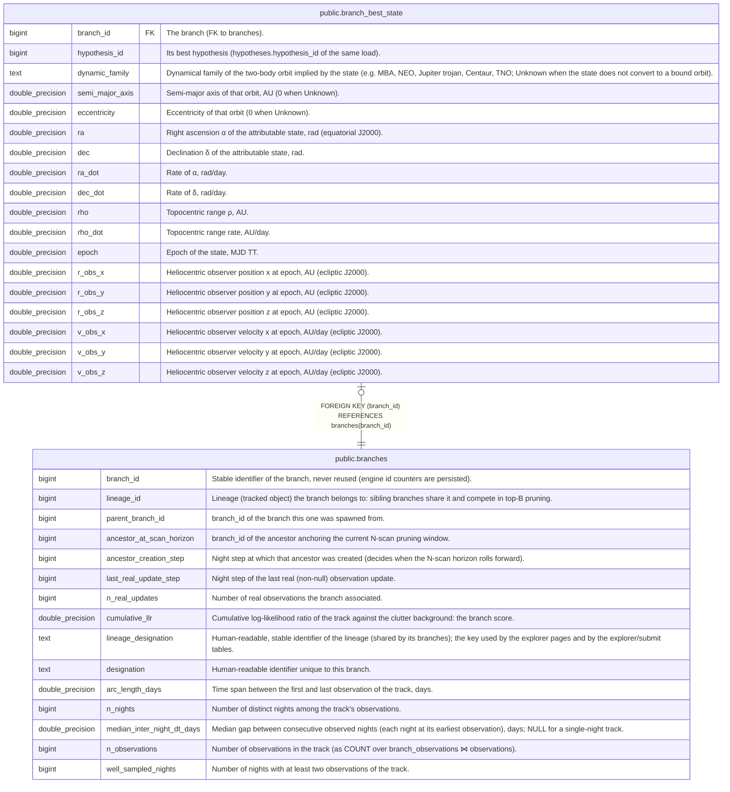

# public.branch_best_state

## Description

One row per branch: copy of the state of its best hypothesis (largest log_weight), denormalized so the explorer homepage reads one row per branch instead of probing hypotheses and kf_state. Covariance and Kalman gain are left out.

## Columns

| Name            | Type             | Default | Nullable | Children | Parents                               | Comment                                                                                                                                                              |
| --------------- | ---------------- | ------- | -------- | -------- | ------------------------------------- | -------------------------------------------------------------------------------------------------------------------------------------------------------------------- |
| branch_id       | bigint           |         | false    |          | [public.branches](public.branches.md) | The branch (FK to branches).                                                                                                                                         |
| hypothesis_id   | bigint           |         | false    |          |                                       | Its best hypothesis (hypotheses.hypothesis_id of the same load).                                                                                                     |
| dynamic_family  | text             |         | false    |          |                                       | Dynamical family of the two-body orbit implied by the state (e.g. MBA, NEO, Jupiter trojan, Centaur, TNO; Unknown when the state does not convert to a bound orbit). |
| semi_major_axis | double precision |         | false    |          |                                       | Semi-major axis of that orbit, AU (0 when Unknown).                                                                                                                  |
| eccentricity    | double precision |         | false    |          |                                       | Eccentricity of that orbit (0 when Unknown).                                                                                                                         |
| ra              | double precision |         | false    |          |                                       | Right ascension α of the attributable state, rad (equatorial J2000).                                                                                                 |
| dec             | double precision |         | false    |          |                                       | Declination δ of the attributable state, rad.                                                                                                                        |
| ra_dot          | double precision |         | false    |          |                                       | Rate of α, rad/day.                                                                                                                                                  |
| dec_dot         | double precision |         | false    |          |                                       | Rate of δ, rad/day.                                                                                                                                                  |
| rho             | double precision |         | false    |          |                                       | Topocentric range ρ, AU.                                                                                                                                             |
| rho_dot         | double precision |         | false    |          |                                       | Topocentric range rate, AU/day.                                                                                                                                      |
| epoch           | double precision |         | false    |          |                                       | Epoch of the state, MJD TT.                                                                                                                                          |
| r_obs_x         | double precision |         | false    |          |                                       | Heliocentric observer position x at epoch, AU (ecliptic J2000).                                                                                                      |
| r_obs_y         | double precision |         | false    |          |                                       | Heliocentric observer position y at epoch, AU (ecliptic J2000).                                                                                                      |
| r_obs_z         | double precision |         | false    |          |                                       | Heliocentric observer position z at epoch, AU (ecliptic J2000).                                                                                                      |
| v_obs_x         | double precision |         | false    |          |                                       | Heliocentric observer velocity x at epoch, AU/day (ecliptic J2000).                                                                                                  |
| v_obs_y         | double precision |         | false    |          |                                       | Heliocentric observer velocity y at epoch, AU/day (ecliptic J2000).                                                                                                  |
| v_obs_z         | double precision |         | false    |          |                                       | Heliocentric observer velocity z at epoch, AU/day (ecliptic J2000).                                                                                                  |

## Constraints

| Name                                       | Type        | Definition                                             |
| ------------------------------------------ | ----------- | ------------------------------------------------------ |
| branch_best_state_branch_id_not_null       | n           | NOT NULL branch_id                                     |
| branch_best_state_dec_dot_not_null         | n           | NOT NULL dec_dot                                       |
| branch_best_state_dec_not_null             | n           | NOT NULL "dec"                                         |
| branch_best_state_dynamic_family_not_null  | n           | NOT NULL dynamic_family                                |
| branch_best_state_eccentricity_not_null    | n           | NOT NULL eccentricity                                  |
| branch_best_state_epoch_not_null           | n           | NOT NULL epoch                                         |
| branch_best_state_hypothesis_id_not_null   | n           | NOT NULL hypothesis_id                                 |
| branch_best_state_r_obs_x_not_null         | n           | NOT NULL r_obs_x                                       |
| branch_best_state_r_obs_y_not_null         | n           | NOT NULL r_obs_y                                       |
| branch_best_state_r_obs_z_not_null         | n           | NOT NULL r_obs_z                                       |
| branch_best_state_ra_dot_not_null          | n           | NOT NULL ra_dot                                        |
| branch_best_state_ra_not_null              | n           | NOT NULL ra                                            |
| branch_best_state_rho_dot_not_null         | n           | NOT NULL rho_dot                                       |
| branch_best_state_rho_not_null             | n           | NOT NULL rho                                           |
| branch_best_state_semi_major_axis_not_null | n           | NOT NULL semi_major_axis                               |
| branch_best_state_v_obs_x_not_null         | n           | NOT NULL v_obs_x                                       |
| branch_best_state_v_obs_y_not_null         | n           | NOT NULL v_obs_y                                       |
| branch_best_state_v_obs_z_not_null         | n           | NOT NULL v_obs_z                                       |
| branch_best_state_branch_id_fkey           | FOREIGN KEY | FOREIGN KEY (branch_id) REFERENCES branches(branch_id) |
| branch_best_state_pkey                     | PRIMARY KEY | PRIMARY KEY (branch_id)                                |

## Indexes

| Name                   | Definition                                                                                     |
| ---------------------- | ---------------------------------------------------------------------------------------------- |
| branch_best_state_pkey | CREATE UNIQUE INDEX branch_best_state_pkey ON public.branch_best_state USING btree (branch_id) |

## Relations

---

> Generated by [tbls](https://github.com/k1LoW/tbls)
