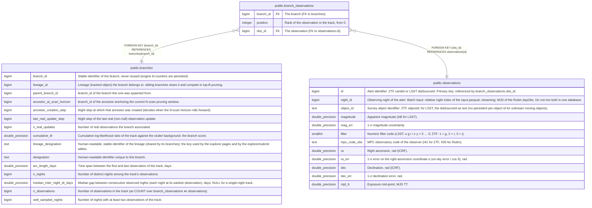

# public.branch_observations

## Description

Association history of each branch: one row per observation of its track, in track order.

## Columns

| Name      | Type    | Default | Nullable | Children | Parents                                       | Comment                                       |
| --------- | ------- | ------- | -------- | -------- | --------------------------------------------- | --------------------------------------------- |
| branch_id | bigint  |         | false    |          | [public.branches](public.branches.md)         | The branch (FK to branches).                  |
| position  | integer |         | false    |          |                                               | Rank of the observation in the track, from 0. |
| obs_id    | bigint  |         | false    |          | [public.observations](public.observations.md) | The observation (FK to observations.id).      |

## Constraints

| Name                                   | Type        | Definition                                             |
| -------------------------------------- | ----------- | ------------------------------------------------------ |
| branch_observations_branch_id_not_null | n           | NOT NULL branch_id                                     |
| branch_observations_obs_id_not_null    | n           | NOT NULL obs_id                                        |
| branch_observations_position_not_null  | n           | NOT NULL "position"                                    |
| branch_observations_obs_id_fkey        | FOREIGN KEY | FOREIGN KEY (obs_id) REFERENCES observations(id)       |
| branch_observations_branch_id_fkey     | FOREIGN KEY | FOREIGN KEY (branch_id) REFERENCES branches(branch_id) |
| branch_observations_pkey               | PRIMARY KEY | PRIMARY KEY (branch_id, "position")                    |

## Indexes

| Name                           | Definition                                                                                                     |
| ------------------------------ | -------------------------------------------------------------------------------------------------------------- |
| branch_observations_pkey       | CREATE UNIQUE INDEX branch_observations_pkey ON public.branch_observations USING btree (branch_id, "position") |
| idx_branch_observations_obs_id | CREATE INDEX idx_branch_observations_obs_id ON public.branch_observations USING btree (obs_id)                 |

## Relations

---

> Generated by [tbls](https://github.com/k1LoW/tbls)
