# public.branches

## Description

One row per live branch of the multi-hypothesis tracker: one candidate association history of one tracked object (its lineage), with its score and precomputed observation statistics. Replaced as a whole by every load (convert, or the streaming pipeline's nightly swap).

## Columns

| Name                       | Type             | Default | Nullable | Children                                                                                                                                                                                                                                                                                                                                                                                                                                                      | Parents | Comment                                                                                                                                          |
| -------------------------- | ---------------- | ------- | -------- | ------------------------------------------------------------------------------------------------------------------------------------------------------------------------------------------------------------------------------------------------------------------------------------------------------------------------------------------------------------------------------------------------------------------------------------------------------------- | ------- | ------------------------------------------------------------------------------------------------------------------------------------------------ |
| branch_id                  | bigint           |         | false    | [public.kf_bank](public.kf_bank.md) [public.branch_observations](public.branch_observations.md) [public.hypotheses](public.hypotheses.md) [public.branch_best_state](public.branch_best_state.md) [public.orbit_fits](public.orbit_fits.md) [public.orbit_fit_failures](public.orbit_fit_failures.md) [public.cnd_queries](public.cnd_queries.md) [public.skybot_obs_status](public.skybot_obs_status.md) [public.mpc_submissions](public.mpc_submissions.md) |         | Stable identifier of the branch, never reused (engine id counters are persisted).                                                                |
| lineage_id                 | bigint           |         | false    |                                                                                                                                                                                                                                                                                                                                                                                                                                                               |         | Lineage (tracked object) the branch belongs to: sibling branches share it and compete in top-B pruning.                                          |
| parent_branch_id           | bigint           |         | false    |                                                                                                                                                                                                                                                                                                                                                                                                                                                               |         | branch_id of the branch this one was spawned from.                                                                                               |
| ancestor_at_scan_horizon   | bigint           |         | false    |                                                                                                                                                                                                                                                                                                                                                                                                                                                               |         | branch_id of the ancestor anchoring the current N-scan pruning window.                                                                           |
| ancestor_creation_step     | bigint           |         | false    |                                                                                                                                                                                                                                                                                                                                                                                                                                                               |         | Night step at which that ancestor was created (decides when the N-scan horizon rolls forward).                                                   |
| last_real_update_step      | bigint           |         | false    |                                                                                                                                                                                                                                                                                                                                                                                                                                                               |         | Night step of the last real (non-null) observation update.                                                                                       |
| n_real_updates             | bigint           |         | false    |                                                                                                                                                                                                                                                                                                                                                                                                                                                               |         | Number of real observations the branch associated.                                                                                               |
| cumulative_llr             | double precision |         | false    |                                                                                                                                                                                                                                                                                                                                                                                                                                                               |         | Cumulative log-likelihood ratio of the track against the clutter background: the branch score.                                                   |
| lineage_designation        | text             |         | false    |                                                                                                                                                                                                                                                                                                                                                                                                                                                               |         | Human-readable, stable identifier of the lineage (shared by its branches); the key used by the explorer pages and by the explorer/submit tables. |
| designation                | text             |         | false    |                                                                                                                                                                                                                                                                                                                                                                                                                                                               |         | Human-readable identifier unique to this branch.                                                                                                 |
| arc_length_days            | double precision |         | false    |                                                                                                                                                                                                                                                                                                                                                                                                                                                               |         | Time span between the first and last observation of the track, days.                                                                             |
| n_nights                   | bigint           |         | false    |                                                                                                                                                                                                                                                                                                                                                                                                                                                               |         | Number of distinct nights among the track's observations.                                                                                        |
| median_inter_night_dt_days | double precision |         | true     |                                                                                                                                                                                                                                                                                                                                                                                                                                                               |         | Median gap between consecutive observed nights (each night at its earliest observation), days; NULL for a single-night track.                    |
| n_observations             | bigint           |         | false    |                                                                                                                                                                                                                                                                                                                                                                                                                                                               |         | Number of observations in the track (as COUNT over branch_observations ⋈ observations).                                                          |
| well_sampled_nights        | bigint           |         | false    |                                                                                                                                                                                                                                                                                                                                                                                                                                                               |         | Number of nights with at least two observations of the track.                                                                                    |

## Constraints

| Name                                       | Type        | Definition                        |
| ------------------------------------------ | ----------- | --------------------------------- |
| branches_ancestor_at_scan_horizon_not_null | n           | NOT NULL ancestor_at_scan_horizon |
| branches_ancestor_creation_step_not_null   | n           | NOT NULL ancestor_creation_step   |
| branches_arc_length_days_not_null          | n           | NOT NULL arc_length_days          |
| branches_branch_id_not_null                | n           | NOT NULL branch_id                |
| branches_cumulative_llr_not_null           | n           | NOT NULL cumulative_llr           |
| branches_designation_not_null              | n           | NOT NULL designation              |
| branches_last_real_update_step_not_null    | n           | NOT NULL last_real_update_step    |
| branches_lineage_designation_not_null      | n           | NOT NULL lineage_designation      |
| branches_lineage_id_not_null               | n           | NOT NULL lineage_id               |
| branches_n_nights_not_null                 | n           | NOT NULL n_nights                 |
| branches_n_observations_not_null           | n           | NOT NULL n_observations           |
| branches_n_real_updates_not_null           | n           | NOT NULL n_real_updates           |
| branches_parent_branch_id_not_null         | n           | NOT NULL parent_branch_id         |
| branches_well_sampled_nights_not_null      | n           | NOT NULL well_sampled_nights      |
| branches_pkey                              | PRIMARY KEY | PRIMARY KEY (branch_id)           |

## Indexes

| Name                             | Definition                                                                                         |
| -------------------------------- | -------------------------------------------------------------------------------------------------- |
| branches_pkey                    | CREATE UNIQUE INDEX branches_pkey ON public.branches USING btree (branch_id)                       |
| idx_branches_lineage_designation | CREATE INDEX idx_branches_lineage_designation ON public.branches USING btree (lineage_designation) |
| idx_branches_lineage_id          | CREATE INDEX idx_branches_lineage_id ON public.branches USING btree (lineage_id)                   |

## Relations

```mermaid
erDiagram

"public.kf_bank" |o--|| "public.branches" : "FOREIGN KEY (branch_id) REFERENCES branches(branch_id)"
"public.branch_observations" }o--|| "public.branches" : "FOREIGN KEY (branch_id) REFERENCES branches(branch_id)"
"public.hypotheses" }o--|| "public.branches" : "FOREIGN KEY (branch_id) REFERENCES branches(branch_id)"
"public.branch_best_state" |o--|| "public.branches" : "FOREIGN KEY (branch_id) REFERENCES branches(branch_id)"
"public.orbit_fits" }o--o| "public.branches" : "by value, no FK"
"public.orbit_fit_failures" }o--|| "public.branches" : "by value, no FK"
"public.cnd_queries" }o--o| "public.branches" : "by value, no FK"
"public.skybot_obs_status" }o--|| "public.branches" : "by value, no FK"
"public.mpc_submissions" }o--o| "public.branches" : "by value, no FK"

"public.branches" {
  bigint branch_id "Stable identifier of the branch, never reused (engine id counters are persisted)."
  bigint lineage_id "Lineage (tracked object) the branch belongs to: sibling branches share it and compete in top-B pruning."
  bigint parent_branch_id "branch_id of the branch this one was spawned from."
  bigint ancestor_at_scan_horizon "branch_id of the ancestor anchoring the current N-scan pruning window."
  bigint ancestor_creation_step "Night step at which that ancestor was created (decides when the N-scan horizon rolls forward)."
  bigint last_real_update_step "Night step of the last real (non-null) observation update."
  bigint n_real_updates "Number of real observations the branch associated."
  double_precision cumulative_llr "Cumulative log-likelihood ratio of the track against the clutter background: the branch score."
  text lineage_designation "Human-readable, stable identifier of the lineage (shared by its branches); the key used by the explorer pages and by the explorer/submit tables."
  text designation "Human-readable identifier unique to this branch."
  double_precision arc_length_days "Time span between the first and last observation of the track, days."
  bigint n_nights "Number of distinct nights among the track's observations."
  double_precision median_inter_night_dt_days "Median gap between consecutive observed nights (each night at its earliest observation), days; NULL for a single-night track."
  bigint n_observations "Number of observations in the track (as COUNT over branch_observations ⋈ observations)."
  bigint well_sampled_nights "Number of nights with at least two observations of the track."
}
"public.kf_bank" {
  bigint branch_id FK "The branch (FK to branches)."
  bigint n_steps "Number of observation steps the bank processed (drives the hypothesis-cap schedule)."
  double_precision absolute_magnitude_estimate "Running estimate of the absolute magnitude H (with H-G phase correction); NULL before the first real observation."
  integer absolute_magnitude_sample_count "Number of observations folded into absolute_magnitude_estimate."
}
"public.branch_observations" {
  bigint branch_id FK "The branch (FK to branches)."
  integer position "Rank of the observation in the track, from 0."
  bigint obs_id FK "The observation (FK to observations.id)."
}
"public.hypotheses" {
  bigint hypothesis_id "Identifier of the row, allocated sequentially at load time (not stable across loads)."
  bigint branch_id FK "The branch (FK to branches)."
  bigint local_hyp_id "Stable identifier of the hypothesis within its bank."
  double_precision log_weight "Log of the hypothesis' posterior weight in the mixture."
  double_precision__ recent_log_liks "Log-likelihoods of the most recent updates (sliding window), used by the smoothed hypothesis pruning."
}
"public.branch_best_state" {
  bigint branch_id FK "The branch (FK to branches)."
  bigint hypothesis_id "Its best hypothesis (hypotheses.hypothesis_id of the same load)."
  text dynamic_family "Dynamical family of the two-body orbit implied by the state (e.g. MBA, NEO, Jupiter trojan, Centaur, TNO; Unknown when the state does not convert to a bound orbit)."
  double_precision semi_major_axis "Semi-major axis of that orbit, AU (0 when Unknown)."
  double_precision eccentricity "Eccentricity of that orbit (0 when Unknown)."
  double_precision ra "Right ascension α of the attributable state, rad (equatorial J2000)."
  double_precision dec "Declination δ of the attributable state, rad."
  double_precision ra_dot "Rate of α, rad/day."
  double_precision dec_dot "Rate of δ, rad/day."
  double_precision rho "Topocentric range ρ, AU."
  double_precision rho_dot "Topocentric range rate, AU/day."
  double_precision epoch "Epoch of the state, MJD TT."
  double_precision r_obs_x "Heliocentric observer position x at epoch, AU (ecliptic J2000)."
  double_precision r_obs_y "Heliocentric observer position y at epoch, AU (ecliptic J2000)."
  double_precision r_obs_z "Heliocentric observer position z at epoch, AU (ecliptic J2000)."
  double_precision v_obs_x "Heliocentric observer velocity x at epoch, AU/day (ecliptic J2000)."
  double_precision v_obs_y "Heliocentric observer velocity y at epoch, AU/day (ecliptic J2000)."
  double_precision v_obs_z "Heliocentric observer velocity z at epoch, AU/day (ecliptic J2000)."
}
"public.orbit_fits" {
  bigint id "Identifier of the fit."
  text lineage_designation "Lineage fitted (branches.lineage_designation, by value)."
  bigint branch_id "Branch fitted (branches.branch_id, by value); NULL for rows written before per-branch fits existed."
  timestamp_with_time_zone fitted_at "When the fit was stored."
  bigint__ observation_ids "Observations submitted to the fit (observations.id), before outlier rejection."
  integer n_observations_used "Observations kept by the fit after outlier rejection."
  text error_model "Astrometric error model used to weight the observations."
  text fit_method "differential_correction for a converged least-squares fit; otherwise the IOD-only fallback (the bulk fit keeps the Gauss solution when the correction diverges)."
  jsonb fit_params "Full fit parameters, as JSON (to reload a past configuration)."
  double_precision reference_epoch "Epoch of the elements, MJD."
  double_precision semi_major_axis "Equinoctial a: semi-major axis, AU."
  double_precision eccentricity_sin_lon "Equinoctial h = e·sin(Ω + ω)."
  double_precision eccentricity_cos_lon "Equinoctial k = e·cos(Ω + ω)."
  double_precision tan_half_incl_sin_node "Equinoctial p = tan(i/2)·sin Ω."
  double_precision tan_half_incl_cos_node "Equinoctial q = tan(i/2)·cos Ω."
  double_precision mean_longitude "Equinoctial λ = Ω + ω + M, rad."
  double_precision__ covariance "6×6 covariance of the equinoctial elements, row-major, 36 values."
  double_precision normalised_rms "Normalized RMS of the astrometric residuals."
  integer total_newton_iterations "Iterations of the differential correction."
  integer num_measurements "Scalar measurements used (two per observation)."
  boolean converged "Whether the differential correction converged."
  jsonb keplerian "Keplerian elements of the fitted orbit, as JSON."
  jsonb delta_vs_previous_fit "Comparison with the previous fit of the lineage, as JSON; NULL for bulk fits."
  jsonb residuals "Per-observation residuals, as JSON."
}
"public.orbit_fit_failures" {
  bigint id "Identifier of the attempt."
  bigint branch_id "Branch whose fit failed (branches.branch_id, by value)."
  timestamp_with_time_zone attempted_at "When the attempt failed."
}
"public.cnd_queries" {
  bigint id "Identifier of the check."
  text lineage_designation "Lineage checked (branches.lineage_designation, by value)."
  bigint branch_id "Branch checked (branches.branch_id, by value); NULL for older rows."
  timestamp_with_time_zone queried_at "When the check ran."
  double_precision time_separation_s "Time tolerance of the near-duplicate search, seconds."
  double_precision angle_separation_arcsec "Angular tolerance of the near-duplicate search, arcsec."
  jsonb hits "Observations with at least one MPC near-duplicate, as a JSON array of CndHit ([] when none)."
}
"public.skybot_obs_status" {
  bigint obs_id "Observation checked (observations.id, by value). Primary key."
  text lineage_designation "Lineage the observation was checked for."
  bigint branch_id "Branch the observation was checked for."
  timestamp_with_time_zone checked_at "When it was last checked."
  double_precision radius_arcsec "Search radius, arcsec."
  jsonb hits "Known objects found, as a JSON array of SkybotHit ([] when none)."
}
"public.mpc_submissions" {
  bigint id "Identifier of the attempt."
  text lineage_designation "Lineage submitted (branches.lineage_designation, by value)."
  bigint branch_id "Branch submitted (branches.branch_id, by value)."
  text trk_sub "Tracklet identifier (ADES trkSub) sent to the MPC."
  text endpoint "test (submit_xml_test) or production (submit_xml)."
  text submission_id "Acknowledgement id returned by the MPC; NULL if the POST failed."
  bigint__ observation_ids "Observations submitted (observations.id, by value); GIN-indexed for the duplicate check."
  text xml "Full ADES payload sent, for audit."
  text ack_message "Acknowledgement message returned by the MPC."
  text ac2_email "Contact email the MPC acknowledgement was sent to."
  timestamp_with_time_zone submitted_at "When the submission was sent."
  text verdict "pending, accepted, rejected or error; refreshed from the explorer's submission dashboard."
  timestamp_with_time_zone verdict_checked_at "When the verdict was last refreshed."
  jsonb verdict_detail "Raw status payload behind the verdict, as JSON."
  jsonb wamo_detail "Per-observation processing status from MPC WAMO, as JSON (production submissions only)."
  timestamp_with_time_zone wamo_checked_at "When wamo_detail was last refreshed."
}
```

---

> Generated by [tbls](https://github.com/k1LoW/tbls)
