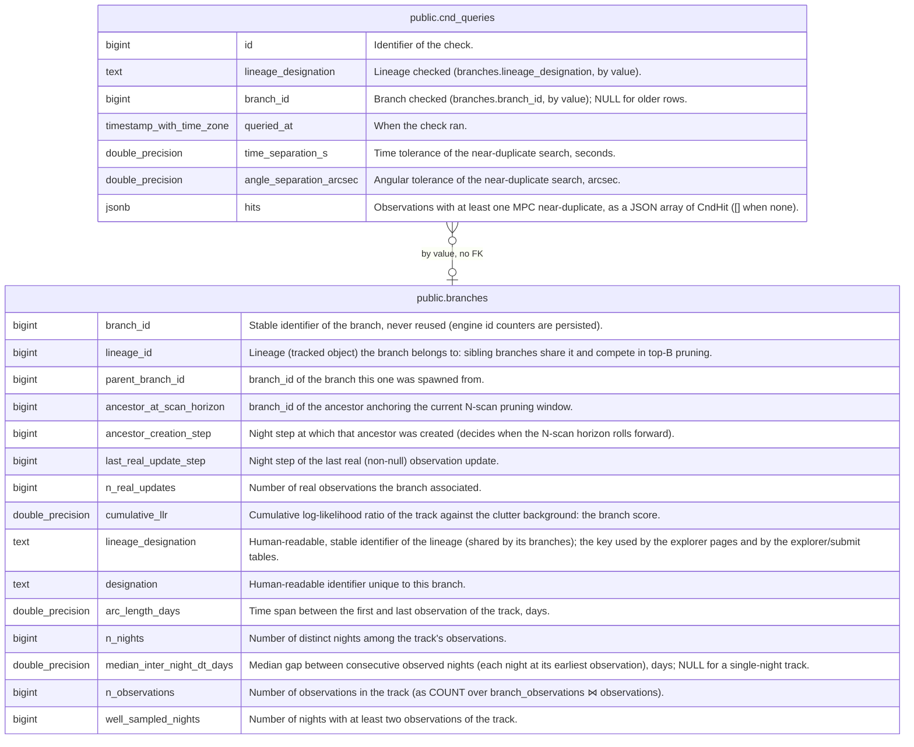

# public.cnd_queries

## Description

MPC Check Near-Duplicates (CND) checks of a lineage's observations, on demand or in bulk: one row per check attempt, including those that found nothing. Owned by fink-fat-explorer, append-only.

## Columns

| Name                    | Type                     | Default | Nullable | Children | Parents                               | Comment                                                                                      |
| ----------------------- | ------------------------ | ------- | -------- | -------- | ------------------------------------- | -------------------------------------------------------------------------------------------- |
| id                      | bigint                   |         | false    |          |                                       | Identifier of the check.                                                                     |
| lineage_designation     | text                     |         | false    |          |                                       | Lineage checked (branches.lineage_designation, by value).                                    |
| branch_id               | bigint                   |         | true     |          | [public.branches](public.branches.md) | Branch checked (branches.branch_id, by value); NULL for older rows.                          |
| queried_at              | timestamp with time zone | now()   | false    |          |                                       | When the check ran.                                                                          |
| time_separation_s       | double precision         |         | false    |          |                                       | Time tolerance of the near-duplicate search, seconds.                                        |
| angle_separation_arcsec | double precision         |         | false    |          |                                       | Angular tolerance of the near-duplicate search, arcsec.                                      |
| hits                    | jsonb                    |         | false    |          |                                       | Observations with at least one MPC near-duplicate, as a JSON array of CndHit ([] when none). |

## Constraints

| Name                                         | Type        | Definition                       |
| -------------------------------------------- | ----------- | -------------------------------- |
| cnd_queries_angle_separation_arcsec_not_null | n           | NOT NULL angle_separation_arcsec |
| cnd_queries_hits_not_null                    | n           | NOT NULL hits                    |
| cnd_queries_id_not_null                      | n           | NOT NULL id                      |
| cnd_queries_lineage_designation_not_null     | n           | NOT NULL lineage_designation     |
| cnd_queries_queried_at_not_null              | n           | NOT NULL queried_at              |
| cnd_queries_time_separation_s_not_null       | n           | NOT NULL time_separation_s       |
| cnd_queries_pkey                             | PRIMARY KEY | PRIMARY KEY (id)                 |

## Indexes

| Name                    | Definition                                                                                                    |
| ----------------------- | ------------------------------------------------------------------------------------------------------------- |
| cnd_queries_pkey        | CREATE UNIQUE INDEX cnd_queries_pkey ON public.cnd_queries USING btree (id)                                   |
| idx_cnd_queries_lineage | CREATE INDEX idx_cnd_queries_lineage ON public.cnd_queries USING btree (lineage_designation, queried_at DESC) |

## Relations

---

> Generated by [tbls](https://github.com/k1LoW/tbls)
