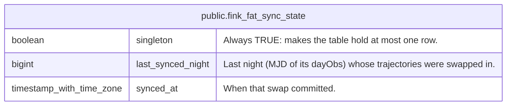

# public.fink_fat_sync_state

## Description

Single-row record of the last nightly swap of the trajectory tables by the streaming pipeline. Empty when no sync ever completed, or after a Postgres crash (UNLOGGED, like the trajectory tables), which makes the pipeline sync again.

## Columns

| Name              | Type                     | Default | Nullable | Children | Parents | Comment                                                            |
| ----------------- | ------------------------ | ------- | -------- | -------- | ------- | ------------------------------------------------------------------ |
| singleton         | boolean                  | true    | false    |          |         | Always TRUE: makes the table hold at most one row.                 |
| last_synced_night | bigint                   |         | false    |          |         | Last night (MJD of its dayObs) whose trajectories were swapped in. |
| synced_at         | timestamp with time zone | now()   | false    |          |         | When that swap committed.                                          |

## Constraints

| Name                                           | Type        | Definition                 |
| ---------------------------------------------- | ----------- | -------------------------- |
| fink_fat_sync_state_last_synced_night_not_null | n           | NOT NULL last_synced_night |
| fink_fat_sync_state_singleton_check            | CHECK       | CHECK (singleton)          |
| fink_fat_sync_state_singleton_not_null         | n           | NOT NULL singleton         |
| fink_fat_sync_state_synced_at_not_null         | n           | NOT NULL synced_at         |
| fink_fat_sync_state_pkey                       | PRIMARY KEY | PRIMARY KEY (singleton)    |

## Indexes

| Name                     | Definition                                                                                         |
| ------------------------ | -------------------------------------------------------------------------------------------------- |
| fink_fat_sync_state_pkey | CREATE UNIQUE INDEX fink_fat_sync_state_pkey ON public.fink_fat_sync_state USING btree (singleton) |

## Relations

---

> Generated by [tbls](https://github.com/k1LoW/tbls)
