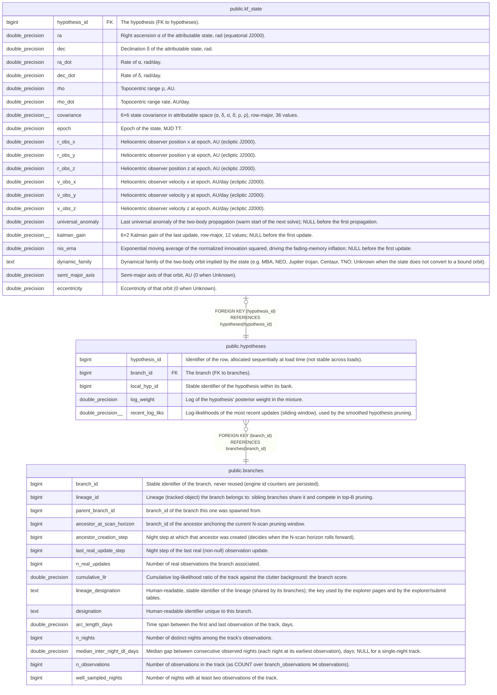

# public.hypotheses

## Description

One row per hypothesis of each branch's Kalman bank: one (ρ, ρ̇) mode of the Gaussian mixture.

## Columns

| Name            | Type               | Default | Nullable | Children                              | Parents                               | Comment                                                                                               |
| --------------- | ------------------ | ------- | -------- | ------------------------------------- | ------------------------------------- | ----------------------------------------------------------------------------------------------------- |
| hypothesis_id   | bigint             |         | false    | [public.kf_state](public.kf_state.md) |                                       | Identifier of the row, allocated sequentially at load time (not stable across loads).                 |
| branch_id       | bigint             |         | false    |                                       | [public.branches](public.branches.md) | The branch (FK to branches).                                                                          |
| local_hyp_id    | bigint             |         | false    |                                       |                                       | Stable identifier of the hypothesis within its bank.                                                  |
| log_weight      | double precision   |         | false    |                                       |                                       | Log of the hypothesis' posterior weight in the mixture.                                               |
| recent_log_liks | double precision[] |         | false    |                                       |                                       | Log-likelihoods of the most recent updates (sliding window), used by the smoothed hypothesis pruning. |

## Constraints

| Name                                | Type        | Definition                                             |
| ----------------------------------- | ----------- | ------------------------------------------------------ |
| hypotheses_branch_id_not_null       | n           | NOT NULL branch_id                                     |
| hypotheses_hypothesis_id_not_null   | n           | NOT NULL hypothesis_id                                 |
| hypotheses_local_hyp_id_not_null    | n           | NOT NULL local_hyp_id                                  |
| hypotheses_log_weight_not_null      | n           | NOT NULL log_weight                                    |
| hypotheses_recent_log_liks_not_null | n           | NOT NULL recent_log_liks                               |
| hypotheses_branch_id_fkey           | FOREIGN KEY | FOREIGN KEY (branch_id) REFERENCES branches(branch_id) |
| hypotheses_pkey                     | PRIMARY KEY | PRIMARY KEY (hypothesis_id)                            |

## Indexes

| Name                             | Definition                                                                                                  |
| -------------------------------- | ----------------------------------------------------------------------------------------------------------- |
| hypotheses_pkey                  | CREATE UNIQUE INDEX hypotheses_pkey ON public.hypotheses USING btree (hypothesis_id)                        |
| idx_hypotheses_branch_log_weight | CREATE INDEX idx_hypotheses_branch_log_weight ON public.hypotheses USING btree (branch_id, log_weight DESC) |

## Relations

---

> Generated by [tbls](https://github.com/k1LoW/tbls)
