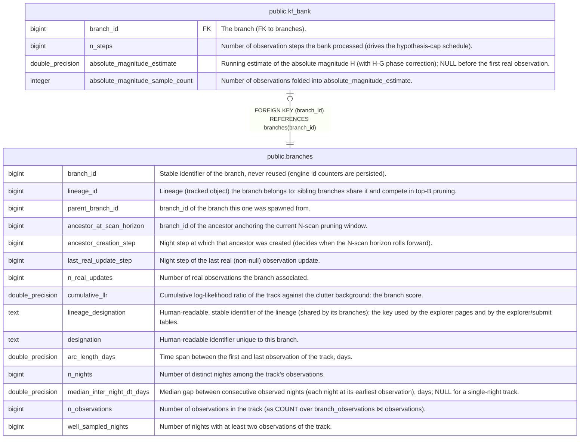

# public.kf_bank

## Description

One row per branch: summary of its Kalman bank (the mixture of (ρ, ρ̇) hypotheses).

## Columns

| Name                            | Type             | Default | Nullable | Children | Parents                               | Comment                                                                                                           |
| ------------------------------- | ---------------- | ------- | -------- | -------- | ------------------------------------- | ----------------------------------------------------------------------------------------------------------------- |
| branch_id                       | bigint           |         | false    |          | [public.branches](public.branches.md) | The branch (FK to branches).                                                                                      |
| n_steps                         | bigint           |         | false    |          |                                       | Number of observation steps the bank processed (drives the hypothesis-cap schedule).                              |
| absolute_magnitude_estimate     | double precision |         | true     |          |                                       | Running estimate of the absolute magnitude H (with H-G phase correction); NULL before the first real observation. |
| absolute_magnitude_sample_count | integer          |         | false    |          |                                       | Number of observations folded into absolute_magnitude_estimate.                                                   |

## Constraints

| Name                                             | Type        | Definition                                             |
| ------------------------------------------------ | ----------- | ------------------------------------------------------ |
| kf_bank_absolute_magnitude_sample_count_not_null | n           | NOT NULL absolute_magnitude_sample_count               |
| kf_bank_branch_id_not_null                       | n           | NOT NULL branch_id                                     |
| kf_bank_n_steps_not_null                         | n           | NOT NULL n_steps                                       |
| kf_bank_branch_id_fkey                           | FOREIGN KEY | FOREIGN KEY (branch_id) REFERENCES branches(branch_id) |
| kf_bank_pkey                                     | PRIMARY KEY | PRIMARY KEY (branch_id)                                |

## Indexes

| Name         | Definition                                                                 |
| ------------ | -------------------------------------------------------------------------- |
| kf_bank_pkey | CREATE UNIQUE INDEX kf_bank_pkey ON public.kf_bank USING btree (branch_id) |

## Relations

---

> Generated by [tbls](https://github.com/k1LoW/tbls)
