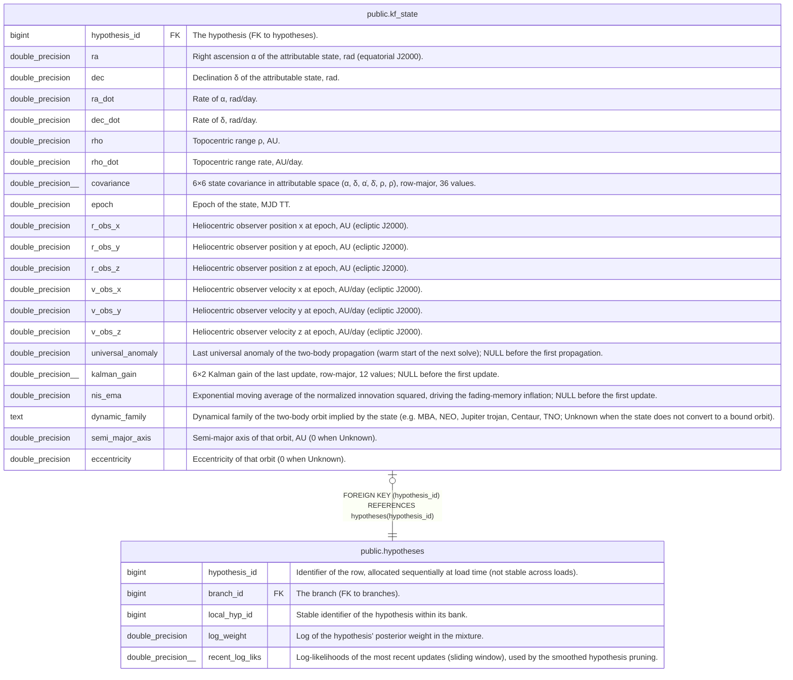

# public.kf_state

## Description

One row per hypothesis: its Kalman state in attributable coordinates (α, δ, α̇, δ̇, ρ, ρ̇), covariance and the dynamical family of the implied orbit.

## Columns

| Name              | Type               | Default | Nullable | Children | Parents                                   | Comment                                                                                                                                                              |
| ----------------- | ------------------ | ------- | -------- | -------- | ----------------------------------------- | -------------------------------------------------------------------------------------------------------------------------------------------------------------------- |
| hypothesis_id     | bigint             |         | false    |          | [public.hypotheses](public.hypotheses.md) | The hypothesis (FK to hypotheses).                                                                                                                                   |
| ra                | double precision   |         | false    |          |                                           | Right ascension α of the attributable state, rad (equatorial J2000).                                                                                                 |
| dec               | double precision   |         | false    |          |                                           | Declination δ of the attributable state, rad.                                                                                                                        |
| ra_dot            | double precision   |         | false    |          |                                           | Rate of α, rad/day.                                                                                                                                                  |
| dec_dot           | double precision   |         | false    |          |                                           | Rate of δ, rad/day.                                                                                                                                                  |
| rho               | double precision   |         | false    |          |                                           | Topocentric range ρ, AU.                                                                                                                                             |
| rho_dot           | double precision   |         | false    |          |                                           | Topocentric range rate, AU/day.                                                                                                                                      |
| covariance        | double precision[] |         | false    |          |                                           | 6×6 state covariance in attributable space (α, δ, α̇, δ̇, ρ, ρ̇), row-major, 36 values.                                                                                 |
| epoch             | double precision   |         | false    |          |                                           | Epoch of the state, MJD TT.                                                                                                                                          |
| r_obs_x           | double precision   |         | false    |          |                                           | Heliocentric observer position x at epoch, AU (ecliptic J2000).                                                                                                      |
| r_obs_y           | double precision   |         | false    |          |                                           | Heliocentric observer position y at epoch, AU (ecliptic J2000).                                                                                                      |
| r_obs_z           | double precision   |         | false    |          |                                           | Heliocentric observer position z at epoch, AU (ecliptic J2000).                                                                                                      |
| v_obs_x           | double precision   |         | false    |          |                                           | Heliocentric observer velocity x at epoch, AU/day (ecliptic J2000).                                                                                                  |
| v_obs_y           | double precision   |         | false    |          |                                           | Heliocentric observer velocity y at epoch, AU/day (ecliptic J2000).                                                                                                  |
| v_obs_z           | double precision   |         | false    |          |                                           | Heliocentric observer velocity z at epoch, AU/day (ecliptic J2000).                                                                                                  |
| universal_anomaly | double precision   |         | true     |          |                                           | Last universal anomaly of the two-body propagation (warm start of the next solve); NULL before the first propagation.                                                |
| kalman_gain       | double precision[] |         | true     |          |                                           | 6×2 Kalman gain of the last update, row-major, 12 values; NULL before the first update.                                                                              |
| nis_ema           | double precision   |         | true     |          |                                           | Exponential moving average of the normalized innovation squared, driving the fading-memory inflation; NULL before the first update.                                  |
| dynamic_family    | text               |         | false    |          |                                           | Dynamical family of the two-body orbit implied by the state (e.g. MBA, NEO, Jupiter trojan, Centaur, TNO; Unknown when the state does not convert to a bound orbit). |
| semi_major_axis   | double precision   |         | false    |          |                                           | Semi-major axis of that orbit, AU (0 when Unknown).                                                                                                                  |
| eccentricity      | double precision   |         | false    |          |                                           | Eccentricity of that orbit (0 when Unknown).                                                                                                                         |

## Constraints

| Name                              | Type        | Definition                                                       |
| --------------------------------- | ----------- | ---------------------------------------------------------------- |
| kf_state_covariance_not_null      | n           | NOT NULL covariance                                              |
| kf_state_dec_dot_not_null         | n           | NOT NULL dec_dot                                                 |
| kf_state_dec_not_null             | n           | NOT NULL "dec"                                                   |
| kf_state_dynamic_family_not_null  | n           | NOT NULL dynamic_family                                          |
| kf_state_eccentricity_not_null    | n           | NOT NULL eccentricity                                            |
| kf_state_epoch_not_null           | n           | NOT NULL epoch                                                   |
| kf_state_hypothesis_id_not_null   | n           | NOT NULL hypothesis_id                                           |
| kf_state_r_obs_x_not_null         | n           | NOT NULL r_obs_x                                                 |
| kf_state_r_obs_y_not_null         | n           | NOT NULL r_obs_y                                                 |
| kf_state_r_obs_z_not_null         | n           | NOT NULL r_obs_z                                                 |
| kf_state_ra_dot_not_null          | n           | NOT NULL ra_dot                                                  |
| kf_state_ra_not_null              | n           | NOT NULL ra                                                      |
| kf_state_rho_dot_not_null         | n           | NOT NULL rho_dot                                                 |
| kf_state_rho_not_null             | n           | NOT NULL rho                                                     |
| kf_state_semi_major_axis_not_null | n           | NOT NULL semi_major_axis                                         |
| kf_state_v_obs_x_not_null         | n           | NOT NULL v_obs_x                                                 |
| kf_state_v_obs_y_not_null         | n           | NOT NULL v_obs_y                                                 |
| kf_state_v_obs_z_not_null         | n           | NOT NULL v_obs_z                                                 |
| kf_state_hypothesis_id_fkey       | FOREIGN KEY | FOREIGN KEY (hypothesis_id) REFERENCES hypotheses(hypothesis_id) |
| kf_state_pkey                     | PRIMARY KEY | PRIMARY KEY (hypothesis_id)                                      |

## Indexes

| Name          | Definition                                                                       |
| ------------- | -------------------------------------------------------------------------------- |
| kf_state_pkey | CREATE UNIQUE INDEX kf_state_pkey ON public.kf_state USING btree (hypothesis_id) |

## Relations

---

> Generated by [tbls](https://github.com/k1LoW/tbls)
