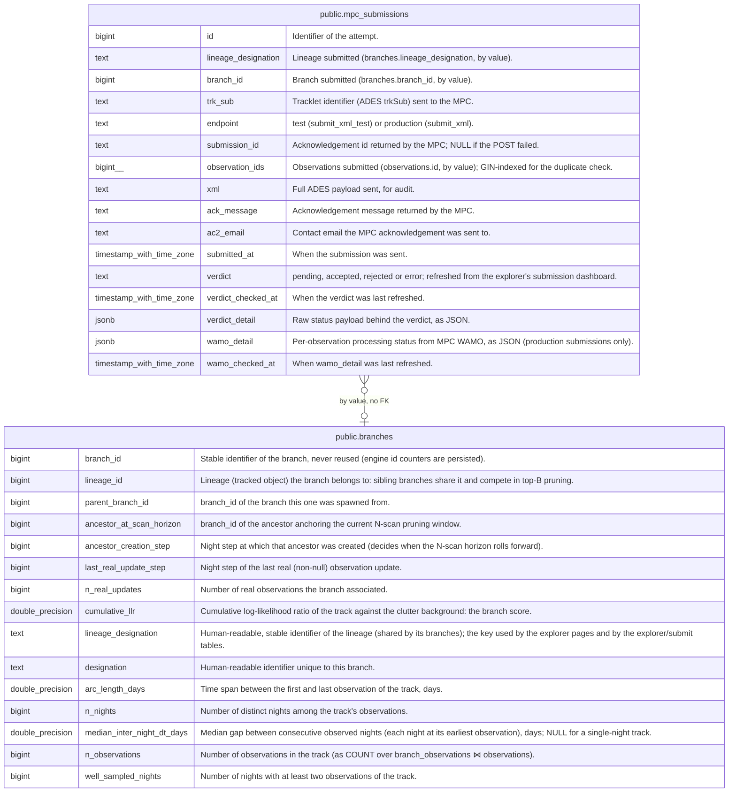

# public.mpc_submissions

## Description

Every MPC submission attempt made by fink-fat submit (ADES XML), and the source of truth for what was already submitted. Owned by submit and the explorer's submission dashboard, append-only.

## Columns

| Name                | Type                     | Default         | Nullable | Children | Parents                               | Comment                                                                                   |
| ------------------- | ------------------------ | --------------- | -------- | -------- | ------------------------------------- | ----------------------------------------------------------------------------------------- |
| id                  | bigint                   |                 | false    |          |                                       | Identifier of the attempt.                                                                |
| lineage_designation | text                     |                 | false    |          |                                       | Lineage submitted (branches.lineage_designation, by value).                               |
| branch_id           | bigint                   |                 | true     |          | [public.branches](public.branches.md) | Branch submitted (branches.branch_id, by value).                                          |
| trk_sub             | text                     |                 | false    |          |                                       | Tracklet identifier (ADES trkSub) sent to the MPC.                                        |
| endpoint            | text                     |                 | false    |          |                                       | test (submit_xml_test) or production (submit_xml).                                        |
| submission_id       | text                     |                 | true     |          |                                       | Acknowledgement id returned by the MPC; NULL if the POST failed.                          |
| observation_ids     | bigint[]                 |                 | false    |          |                                       | Observations submitted (observations.id, by value); GIN-indexed for the duplicate check.  |
| xml                 | text                     |                 | false    |          |                                       | Full ADES payload sent, for audit.                                                        |
| ack_message         | text                     |                 | false    |          |                                       | Acknowledgement message returned by the MPC.                                              |
| ac2_email           | text                     |                 | false    |          |                                       | Contact email the MPC acknowledgement was sent to.                                        |
| submitted_at        | timestamp with time zone | now()           | false    |          |                                       | When the submission was sent.                                                             |
| verdict             | text                     | 'pending'::text | false    |          |                                       | pending, accepted, rejected or error; refreshed from the explorer's submission dashboard. |
| verdict_checked_at  | timestamp with time zone |                 | true     |          |                                       | When the verdict was last refreshed.                                                      |
| verdict_detail      | jsonb                    |                 | true     |          |                                       | Raw status payload behind the verdict, as JSON.                                           |
| wamo_detail         | jsonb                    |                 | true     |          |                                       | Per-observation processing status from MPC WAMO, as JSON (production submissions only).   |
| wamo_checked_at     | timestamp with time zone |                 | true     |          |                                       | When wamo_detail was last refreshed.                                                      |

## Constraints

| Name                                         | Type        | Definition                   |
| -------------------------------------------- | ----------- | ---------------------------- |
| mpc_submissions_ac2_email_not_null           | n           | NOT NULL ac2_email           |
| mpc_submissions_ack_message_not_null         | n           | NOT NULL ack_message         |
| mpc_submissions_endpoint_not_null            | n           | NOT NULL endpoint            |
| mpc_submissions_id_not_null                  | n           | NOT NULL id                  |
| mpc_submissions_lineage_designation_not_null | n           | NOT NULL lineage_designation |
| mpc_submissions_observation_ids_not_null     | n           | NOT NULL observation_ids     |
| mpc_submissions_submitted_at_not_null        | n           | NOT NULL submitted_at        |
| mpc_submissions_trk_sub_not_null             | n           | NOT NULL trk_sub             |
| mpc_submissions_verdict_not_null             | n           | NOT NULL verdict             |
| mpc_submissions_xml_not_null                 | n           | NOT NULL xml                 |
| mpc_submissions_pkey                         | PRIMARY KEY | PRIMARY KEY (id)             |

## Indexes

| Name                                | Definition                                                                                                              |
| ----------------------------------- | ----------------------------------------------------------------------------------------------------------------------- |
| mpc_submissions_pkey                | CREATE UNIQUE INDEX mpc_submissions_pkey ON public.mpc_submissions USING btree (id)                                     |
| idx_mpc_submissions_lineage         | CREATE INDEX idx_mpc_submissions_lineage ON public.mpc_submissions USING btree (lineage_designation, submitted_at DESC) |
| idx_mpc_submissions_submitted_at    | CREATE INDEX idx_mpc_submissions_submitted_at ON public.mpc_submissions USING btree (submitted_at DESC)                 |
| idx_mpc_submissions_observation_ids | CREATE INDEX idx_mpc_submissions_observation_ids ON public.mpc_submissions USING gin (observation_ids)                  |

## Relations

---

> Generated by [tbls](https://github.com/k1LoW/tbls)
