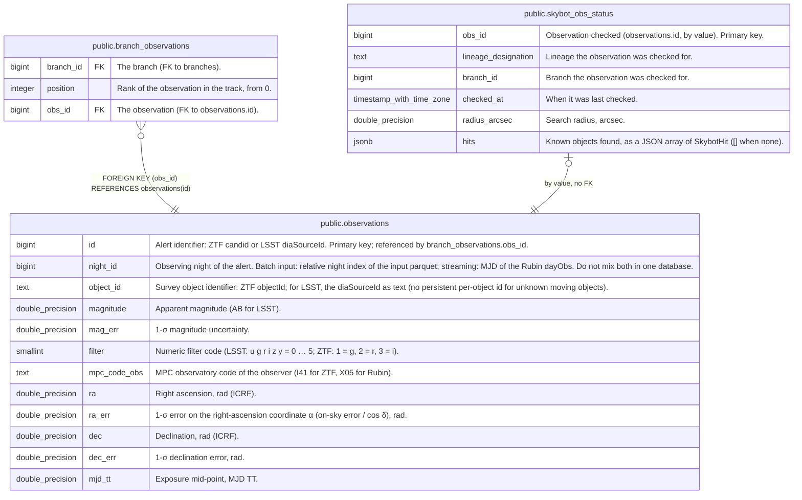

# public.observations

## Description

One row per alert (detection) fed to the tracker: its astrometry, photometry and epoch. Written by fink-fat convert (full reload from a parquet) and by the streaming pipeline (live, idempotent inserts). The only store of past alerts in the database, hence WAL-logged.

## Columns

| Name         | Type             | Default | Nullable | Children                                                                                                            | Parents | Comment                                                                                                                                                    |
| ------------ | ---------------- | ------- | -------- | ------------------------------------------------------------------------------------------------------------------- | ------- | ---------------------------------------------------------------------------------------------------------------------------------------------------------- |
| id           | bigint           |         | false    | [public.branch_observations](public.branch_observations.md) [public.skybot_obs_status](public.skybot_obs_status.md) |         | Alert identifier: ZTF candid or LSST diaSourceId. Primary key; referenced by branch_observations.obs_id.                                                   |
| night_id     | bigint           |         | false    |                                                                                                                     |         | Observing night of the alert. Batch input: relative night index of the input parquet; streaming: MJD of the Rubin dayObs. Do not mix both in one database. |
| object_id    | text             |         | false    |                                                                                                                     |         | Survey object identifier: ZTF objectId; for LSST, the diaSourceId as text (no persistent per-object id for unknown moving objects).                        |
| magnitude    | double precision |         | false    |                                                                                                                     |         | Apparent magnitude (AB for LSST).                                                                                                                          |
| mag_err      | double precision |         | false    |                                                                                                                     |         | 1-σ magnitude uncertainty.                                                                                                                                 |
| filter       | smallint         |         | false    |                                                                                                                     |         | Numeric filter code (LSST: u g r i z y = 0 … 5; ZTF: 1 = g, 2 = r, 3 = i).                                                                                 |
| mpc_code_obs | text             |         | false    |                                                                                                                     |         | MPC observatory code of the observer (I41 for ZTF, X05 for Rubin).                                                                                         |
| ra           | double precision |         | false    |                                                                                                                     |         | Right ascension, rad (ICRF).                                                                                                                               |
| ra_err       | double precision |         | false    |                                                                                                                     |         | 1-σ error on the right-ascension coordinate α (on-sky error / cos δ), rad.                                                                                 |
| dec          | double precision |         | false    |                                                                                                                     |         | Declination, rad (ICRF).                                                                                                                                   |
| dec_err      | double precision |         | false    |                                                                                                                     |         | 1-σ declination error, rad.                                                                                                                                |
| mjd_tt       | double precision |         | false    |                                                                                                                     |         | Exposure mid-point, MJD TT.                                                                                                                                |

## Constraints

| Name                               | Type        | Definition            |
| ---------------------------------- | ----------- | --------------------- |
| observations_dec_err_not_null      | n           | NOT NULL dec_err      |
| observations_dec_not_null          | n           | NOT NULL "dec"        |
| observations_filter_not_null       | n           | NOT NULL filter       |
| observations_id_not_null           | n           | NOT NULL id           |
| observations_mag_err_not_null      | n           | NOT NULL mag_err      |
| observations_magnitude_not_null    | n           | NOT NULL magnitude    |
| observations_mjd_tt_not_null       | n           | NOT NULL mjd_tt       |
| observations_mpc_code_obs_not_null | n           | NOT NULL mpc_code_obs |
| observations_night_id_not_null     | n           | NOT NULL night_id     |
| observations_object_id_not_null    | n           | NOT NULL object_id    |
| observations_ra_err_not_null       | n           | NOT NULL ra_err       |
| observations_ra_not_null           | n           | NOT NULL ra           |
| observations_pkey                  | PRIMARY KEY | PRIMARY KEY (id)      |

## Indexes

| Name                       | Definition                                                                             |
| -------------------------- | -------------------------------------------------------------------------------------- |
| observations_pkey          | CREATE UNIQUE INDEX observations_pkey ON public.observations USING btree (id)          |
| idx_observations_object_id | CREATE INDEX idx_observations_object_id ON public.observations USING btree (object_id) |

## Relations

---

> Generated by [tbls](https://github.com/k1LoW/tbls)
