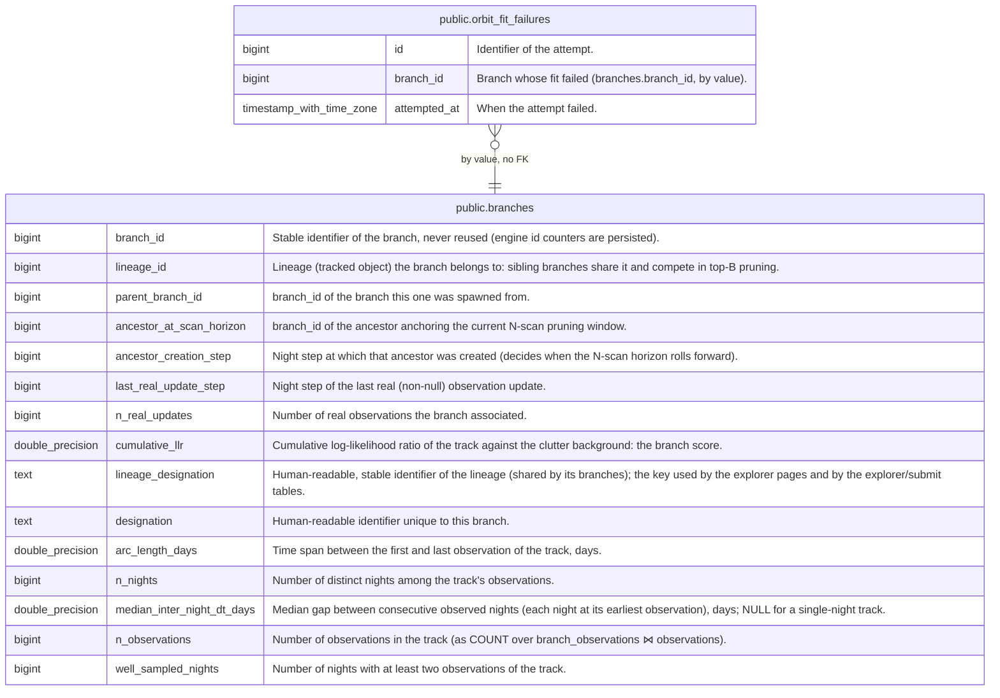

# public.orbit_fit_failures

## Description

One row per failed bulk orbit fit (Gauss IOD found no orbit), so that the homepage quality tier can tell a failed branch from one never submitted. Owned by fink-fat-explorer, append-only.

## Columns

| Name         | Type                     | Default | Nullable | Children | Parents                               | Comment                                                 |
| ------------ | ------------------------ | ------- | -------- | -------- | ------------------------------------- | ------------------------------------------------------- |
| id           | bigint                   |         | false    |          |                                       | Identifier of the attempt.                              |
| branch_id    | bigint                   |         | false    |          | [public.branches](public.branches.md) | Branch whose fit failed (branches.branch_id, by value). |
| attempted_at | timestamp with time zone | now()   | false    |          |                                       | When the attempt failed.                                |

## Constraints

| Name                                     | Type        | Definition            |
| ---------------------------------------- | ----------- | --------------------- |
| orbit_fit_failures_attempted_at_not_null | n           | NOT NULL attempted_at |
| orbit_fit_failures_branch_id_not_null    | n           | NOT NULL branch_id    |
| orbit_fit_failures_id_not_null           | n           | NOT NULL id           |
| orbit_fit_failures_pkey                  | PRIMARY KEY | PRIMARY KEY (id)      |

## Indexes

| Name                          | Definition                                                                                                         |
| ----------------------------- | ------------------------------------------------------------------------------------------------------------------ |
| orbit_fit_failures_pkey       | CREATE UNIQUE INDEX orbit_fit_failures_pkey ON public.orbit_fit_failures USING btree (id)                          |
| idx_orbit_fit_failures_branch | CREATE INDEX idx_orbit_fit_failures_branch ON public.orbit_fit_failures USING btree (branch_id, attempted_at DESC) |

## Relations

---

> Generated by [tbls](https://github.com/k1LoW/tbls)
