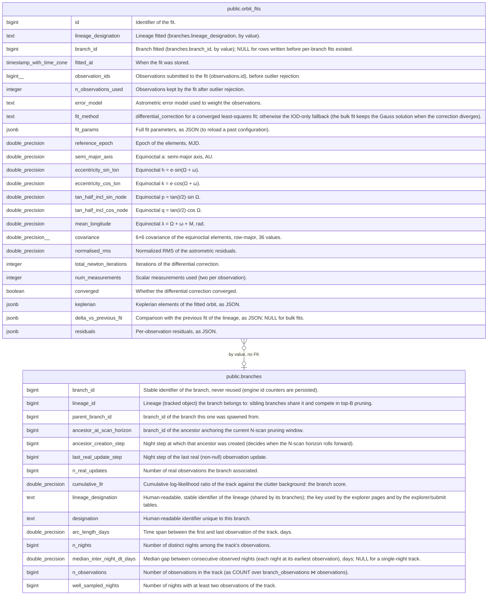

# public.orbit_fits

## Description

Orbit fits computed by fink-fat-explorer (single lineage on demand, or bulk): Gauss IOD then n-body differential correction (outfit). Append-only history, one row per fit; owned by the explorer, never truncated by a load, no FK to the trajectory tables.

## Columns

| Name                    | Type                     | Default                         | Nullable | Children | Parents                               | Comment                                                                                                                                                          |
| ----------------------- | ------------------------ | ------------------------------- | -------- | -------- | ------------------------------------- | ---------------------------------------------------------------------------------------------------------------------------------------------------------------- |
| id                      | bigint                   |                                 | false    |          |                                       | Identifier of the fit.                                                                                                                                           |
| lineage_designation     | text                     |                                 | false    |          |                                       | Lineage fitted (branches.lineage_designation, by value).                                                                                                         |
| branch_id               | bigint                   |                                 | true     |          | [public.branches](public.branches.md) | Branch fitted (branches.branch_id, by value); NULL for rows written before per-branch fits existed.                                                              |
| fitted_at               | timestamp with time zone | now()                           | false    |          |                                       | When the fit was stored.                                                                                                                                         |
| observation_ids         | bigint[]                 |                                 | false    |          |                                       | Observations submitted to the fit (observations.id), before outlier rejection.                                                                                   |
| n_observations_used     | integer                  |                                 | false    |          |                                       | Observations kept by the fit after outlier rejection.                                                                                                            |
| error_model             | text                     |                                 | false    |          |                                       | Astrometric error model used to weight the observations.                                                                                                         |
| fit_method              | text                     | 'differential_correction'::text | false    |          |                                       | differential_correction for a converged least-squares fit; otherwise the IOD-only fallback (the bulk fit keeps the Gauss solution when the correction diverges). |
| fit_params              | jsonb                    |                                 | false    |          |                                       | Full fit parameters, as JSON (to reload a past configuration).                                                                                                   |
| reference_epoch         | double precision         |                                 | false    |          |                                       | Epoch of the elements, MJD.                                                                                                                                      |
| semi_major_axis         | double precision         |                                 | false    |          |                                       | Equinoctial a: semi-major axis, AU.                                                                                                                              |
| eccentricity_sin_lon    | double precision         |                                 | false    |          |                                       | Equinoctial h = e·sin(Ω + ω).                                                                                                                                    |
| eccentricity_cos_lon    | double precision         |                                 | false    |          |                                       | Equinoctial k = e·cos(Ω + ω).                                                                                                                                    |
| tan_half_incl_sin_node  | double precision         |                                 | false    |          |                                       | Equinoctial p = tan(i/2)·sin Ω.                                                                                                                                  |
| tan_half_incl_cos_node  | double precision         |                                 | false    |          |                                       | Equinoctial q = tan(i/2)·cos Ω.                                                                                                                                  |
| mean_longitude          | double precision         |                                 | false    |          |                                       | Equinoctial λ = Ω + ω + M, rad.                                                                                                                                  |
| covariance              | double precision[]       |                                 | false    |          |                                       | 6×6 covariance of the equinoctial elements, row-major, 36 values.                                                                                                |
| normalised_rms          | double precision         |                                 | false    |          |                                       | Normalized RMS of the astrometric residuals.                                                                                                                     |
| total_newton_iterations | integer                  |                                 | false    |          |                                       | Iterations of the differential correction.                                                                                                                       |
| num_measurements        | integer                  |                                 | false    |          |                                       | Scalar measurements used (two per observation).                                                                                                                  |
| converged               | boolean                  |                                 | false    |          |                                       | Whether the differential correction converged.                                                                                                                   |
| keplerian               | jsonb                    |                                 | false    |          |                                       | Keplerian elements of the fitted orbit, as JSON.                                                                                                                 |
| delta_vs_previous_fit   | jsonb                    |                                 | true     |          |                                       | Comparison with the previous fit of the lineage, as JSON; NULL for bulk fits.                                                                                    |
| residuals               | jsonb                    |                                 | false    |          |                                       | Per-observation residuals, as JSON.                                                                                                                              |

## Constraints

| Name                                        | Type        | Definition                       |
| ------------------------------------------- | ----------- | -------------------------------- |
| orbit_fits_converged_not_null               | n           | NOT NULL converged               |
| orbit_fits_covariance_not_null              | n           | NOT NULL covariance              |
| orbit_fits_eccentricity_cos_lon_not_null    | n           | NOT NULL eccentricity_cos_lon    |
| orbit_fits_eccentricity_sin_lon_not_null    | n           | NOT NULL eccentricity_sin_lon    |
| orbit_fits_error_model_not_null             | n           | NOT NULL error_model             |
| orbit_fits_fit_method_not_null              | n           | NOT NULL fit_method              |
| orbit_fits_fit_params_not_null              | n           | NOT NULL fit_params              |
| orbit_fits_fitted_at_not_null               | n           | NOT NULL fitted_at               |
| orbit_fits_id_not_null                      | n           | NOT NULL id                      |
| orbit_fits_keplerian_not_null               | n           | NOT NULL keplerian               |
| orbit_fits_lineage_designation_not_null     | n           | NOT NULL lineage_designation     |
| orbit_fits_mean_longitude_not_null          | n           | NOT NULL mean_longitude          |
| orbit_fits_n_observations_used_not_null     | n           | NOT NULL n_observations_used     |
| orbit_fits_normalised_rms_not_null          | n           | NOT NULL normalised_rms          |
| orbit_fits_num_measurements_not_null        | n           | NOT NULL num_measurements        |
| orbit_fits_observation_ids_not_null         | n           | NOT NULL observation_ids         |
| orbit_fits_reference_epoch_not_null         | n           | NOT NULL reference_epoch         |
| orbit_fits_residuals_not_null               | n           | NOT NULL residuals               |
| orbit_fits_semi_major_axis_not_null         | n           | NOT NULL semi_major_axis         |
| orbit_fits_tan_half_incl_cos_node_not_null  | n           | NOT NULL tan_half_incl_cos_node  |
| orbit_fits_tan_half_incl_sin_node_not_null  | n           | NOT NULL tan_half_incl_sin_node  |
| orbit_fits_total_newton_iterations_not_null | n           | NOT NULL total_newton_iterations |
| orbit_fits_pkey                             | PRIMARY KEY | PRIMARY KEY (id)                 |

## Indexes

| Name                   | Definition                                                                                                 |
| ---------------------- | ---------------------------------------------------------------------------------------------------------- |
| orbit_fits_pkey        | CREATE UNIQUE INDEX orbit_fits_pkey ON public.orbit_fits USING btree (id)                                  |
| idx_orbit_fits_lineage | CREATE INDEX idx_orbit_fits_lineage ON public.orbit_fits USING btree (lineage_designation, fitted_at DESC) |
| idx_orbit_fits_branch  | CREATE INDEX idx_orbit_fits_branch ON public.orbit_fits USING btree (branch_id, fitted_at DESC)            |

## Relations

---

> Generated by [tbls](https://github.com/k1LoW/tbls)
