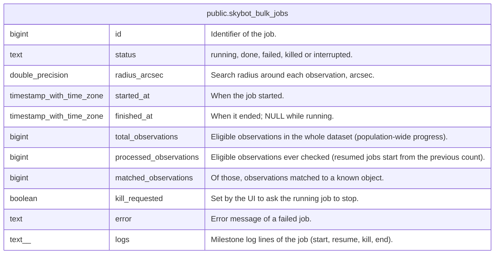

# public.skybot_bulk_jobs

## Description

One row per attempt of the explorer's bulk Skybot sweep (cross-match of every eligible observation with known objects). A partial unique index allows at most one running job.

## Columns

| Name                   | Type                     | Default      | Nullable | Children | Parents | Comment                                                                          |
| ---------------------- | ------------------------ | ------------ | -------- | -------- | ------- | -------------------------------------------------------------------------------- |
| id                     | bigint                   |              | false    |          |         | Identifier of the job.                                                           |
| status                 | text                     |              | false    |          |         | running, done, failed, killed or interrupted.                                    |
| radius_arcsec          | double precision         |              | false    |          |         | Search radius around each observation, arcsec.                                   |
| started_at             | timestamp with time zone | now()        | false    |          |         | When the job started.                                                            |
| finished_at            | timestamp with time zone |              | true     |          |         | When it ended; NULL while running.                                               |
| total_observations     | bigint                   |              | false    |          |         | Eligible observations in the whole dataset (population-wide progress).           |
| processed_observations | bigint                   | 0            | false    |          |         | Eligible observations ever checked (resumed jobs start from the previous count). |
| matched_observations   | bigint                   | 0            | false    |          |         | Of those, observations matched to a known object.                                |
| kill_requested         | boolean                  | false        | false    |          |         | Set by the UI to ask the running job to stop.                                    |
| error                  | text                     |              | true     |          |         | Error message of a failed job.                                                   |
| logs                   | text[]                   | '{}'::text[] | false    |          |         | Milestone log lines of the job (start, resume, kill, end).                       |

## Constraints

| Name                                             | Type        | Definition                      |
| ------------------------------------------------ | ----------- | ------------------------------- |
| skybot_bulk_jobs_id_not_null                     | n           | NOT NULL id                     |
| skybot_bulk_jobs_kill_requested_not_null         | n           | NOT NULL kill_requested         |
| skybot_bulk_jobs_logs_not_null                   | n           | NOT NULL logs                   |
| skybot_bulk_jobs_matched_observations_not_null   | n           | NOT NULL matched_observations   |
| skybot_bulk_jobs_processed_observations_not_null | n           | NOT NULL processed_observations |
| skybot_bulk_jobs_radius_arcsec_not_null          | n           | NOT NULL radius_arcsec          |
| skybot_bulk_jobs_started_at_not_null             | n           | NOT NULL started_at             |
| skybot_bulk_jobs_status_not_null                 | n           | NOT NULL status                 |
| skybot_bulk_jobs_total_observations_not_null     | n           | NOT NULL total_observations     |
| skybot_bulk_jobs_pkey                            | PRIMARY KEY | PRIMARY KEY (id)                |

## Indexes

| Name                                | Definition                                                                                                                            |
| ----------------------------------- | ------------------------------------------------------------------------------------------------------------------------------------- |
| skybot_bulk_jobs_pkey               | CREATE UNIQUE INDEX skybot_bulk_jobs_pkey ON public.skybot_bulk_jobs USING btree (id)                                                 |
| idx_skybot_bulk_jobs_single_running | CREATE UNIQUE INDEX idx_skybot_bulk_jobs_single_running ON public.skybot_bulk_jobs USING btree ((1)) WHERE (status = 'running'::text) |
| idx_skybot_bulk_jobs_started_at     | CREATE INDEX idx_skybot_bulk_jobs_started_at ON public.skybot_bulk_jobs USING btree (started_at DESC)                                 |

## Relations

---

> Generated by [tbls](https://github.com/k1LoW/tbls)
