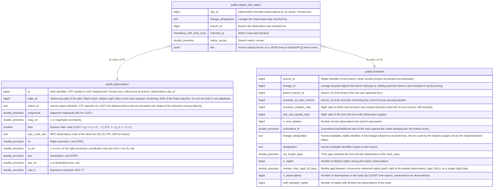

# public.skybot_obs_status

## Description

One row per observation ever checked by Skybot (bulk sweep or per-lineage search), upserted on obs_id: the single source of truth of Skybot results. Only written on a successful request.

## Columns

| Name                | Type                     | Default | Nullable | Children | Parents                                       | Comment                                                           |
| ------------------- | ------------------------ | ------- | -------- | -------- | --------------------------------------------- | ----------------------------------------------------------------- |
| obs_id              | bigint                   |         | false    |          | [public.observations](public.observations.md) | Observation checked (observations.id, by value). Primary key.     |
| lineage_designation | text                     |         | false    |          |                                               | Lineage the observation was checked for.                          |
| branch_id           | bigint                   |         | false    |          | [public.branches](public.branches.md)         | Branch the observation was checked for.                           |
| checked_at          | timestamp with time zone |         | false    |          |                                               | When it was last checked.                                         |
| radius_arcsec       | double precision         |         | false    |          |                                               | Search radius, arcsec.                                            |
| hits                | jsonb                    |         | false    |          |                                               | Known objects found, as a JSON array of SkybotHit ([] when none). |

## Constraints

| Name                                           | Type        | Definition                   |
| ---------------------------------------------- | ----------- | ---------------------------- |
| skybot_obs_status_branch_id_not_null           | n           | NOT NULL branch_id           |
| skybot_obs_status_checked_at_not_null          | n           | NOT NULL checked_at          |
| skybot_obs_status_hits_not_null                | n           | NOT NULL hits                |
| skybot_obs_status_lineage_designation_not_null | n           | NOT NULL lineage_designation |
| skybot_obs_status_obs_id_not_null              | n           | NOT NULL obs_id              |
| skybot_obs_status_radius_arcsec_not_null       | n           | NOT NULL radius_arcsec       |
| skybot_obs_status_pkey                         | PRIMARY KEY | PRIMARY KEY (obs_id)         |

## Indexes

| Name                             | Definition                                                                                               |
| -------------------------------- | -------------------------------------------------------------------------------------------------------- |
| skybot_obs_status_pkey           | CREATE UNIQUE INDEX skybot_obs_status_pkey ON public.skybot_obs_status USING btree (obs_id)              |
| idx_skybot_obs_status_checked_at | CREATE INDEX idx_skybot_obs_status_checked_at ON public.skybot_obs_status USING btree (checked_at)       |
| idx_skybot_obs_status_lineage    | CREATE INDEX idx_skybot_obs_status_lineage ON public.skybot_obs_status USING btree (lineage_designation) |

## Relations

---

> Generated by [tbls](https://github.com/k1LoW/tbls)
